# 🌊 Ocean CTF

一个开箱即用的 **动态 Flag / 练习靶场 / 比赛平台**，支持容器化题目、题库管理、排行榜、公告通知，以及漏洞复现（Vulhub/自维护库）等能力，适合学校社团、战队训练、内部演练与小型赛事。

## 🔥 立刻开始（推荐）

- **赛事版在线体验**：http://ctf-docs.lostpeach.cn

## 🎯 适用场景

- **训练靶场**：战队日常训练、课程实验、入门练习
- **小型比赛**：校内赛/社团赛/内部赛快速搭建
- **漏洞复现**：沉淀可复现环境，便于演示与复盘


## ✨ 核心特性

- **动态 Flag**：题目容器化运行，Flag 动态生成
- **题库管理**：题目资源中心、编译（Pull/Build）、题库隔离
- **容器管理**：题目容器启停、实例信息展示、多端口开放
- **作弊检测**：基础反作弊能力
- **公告通知**：用户端顶部通知/公告列表
- **排行榜**：积分排行与记录
- **漏洞复现**：支持导入漏洞资源，提供 WebShell/日志等能力（见下文说明）

## 🗺️ Roadmap

- 大屏展示
- compose 容器支持
- 镜像功能页面重构

## 🚀 在线演示

- **用户端**：http://ctf.lostpeach.cn/
  - 测试账号：`test/test`
- **管理端**：http://ctf.lostpeach.cn/manager
  - 访客账号：`guest/guest`

## 🧩 关联仓库

- 后台管理前端（ocean_manager）：https://github.com/tongchengbin/ocean_manager
- 题库仓库（CTFDB）：https://github.com/tongchengbin/ctfdb

## 📚 赛事版私有化部署文档

- http://ctf-docs.lostpeach.cn/

## 🏁 赛事版（推荐）

- 在线体验：http://ocean.lostpeach.cn
- 私有化部署文档：http://ctf-docs.lostpeach.cn/

赛事版面向 **真实比赛场景** 做了更偏“赛事运营”的能力组合，适合校赛/社团赛/企业内部赛快速落地。

- **赛事运营更友好**：赛事配置/题库投放/公告与通知/排行榜
- **更适合多人并发**：题目容器化与隔离，支持多端口开放
- **更贴近比赛体验**：统一的参赛入口与交互流程

## 📖 快速开始（Docker Compose）

1) 克隆代码

```bash
git clone https://github.com/tongchengbin/ocean_ctf.git /opt/ocean_ctf
```

2) 启动服务

```bash
cd /opt/ocean_ctf
cp .env_example .env
docker-compose up -d
```

3) 初始化系统

- 访问管理端：`/manager`
- 默认管理账号：`admin/admin`

## 使用说明（题库 / 动态题目）

平台支持通过 **资源中心** 管理题目镜像与题库。

说明：实际运行题目更推荐使用 **Docker 方式**（启动/关闭更快、共享更方便、磁盘释放更直观）。因此当前 **CTF 动态题目** 主要以 Docker 启动为主，后续靶场场景会同时完善 docker-compose 与 docker 两种方式。

### 动态题目

通过虚拟化-资源中心添加题目资源，题目资源可以使用本地镜像、远程镜像、如 CTFDB 项目中提供了默认题目可以通过同步功能拉取题库或在[dockerhub](https://hub.docker.com/r/tongchengbin/easy_web)中查看题目

添加资源后需要进行编译（PULL）、因为编译是个比较耗时的操作(和网络环境有关)、所以建议先本地拉取 image 后点击编译按钮。
后续的操作与之前的版本一样、添加赛事题库选择动态题目和对应的资源环境即可。

## 📃 题库

> 题库仓库：[GitHub - tongchengbin/ctfdb: ctf 题库](https://github.com/tongchengbin/ctfdb)

## 💻 题库格式说明

> TODO

### 漏洞复现

漏洞复现支持 vulhub 部分镜像可以直接导入，但是推荐使用[CTFDB Vulnerability](https://github.com/tongchengbin/ctfdb) 仓库进行维护,内置 export 脚本支持自动扫描导出漏洞文件，该文件可以在平台 漏洞复现-漏洞资源中导入

## 开发

### 依赖管理与代码质量

项目使用 `requirements.txt` 来管理依赖，使用 `pyproject.toml` 配置代码质量工具，并使用 Makefile 来简化常用命令。

#### 依赖文件结构

```
requirements/
├── base.txt     # 基础运行时依赖
├── dev.txt      # 开发环境依赖
├── prod.txt     # 生产环境依赖
└── test.txt     # 测试环境依赖

requirements.txt # 生产部署用（指向 prod.txt）
```

#### 安装依赖

```bash
# 安装开发依赖
make install-dev
# 或者直接使用 pip
pip install -r requirements/dev.txt

# 安装生产依赖
make install-prod
# 或者直接使用 pip
pip install -r requirements/prod.txt

# 安装测试依赖
make install-test
# 或者直接使用 pip
pip install -r requirements/test.txt
```

#### 代码质量工具

```bash
# 运行所有代码检查工具
make lint

# 只运行 flake8
make lint-flake8

# 格式化代码（使用 black 和 isort）
make format

# 清理 Python 缓存文件
make clean

# 运行测试
make test
```

#### Docker 构建优化

项目 Dockerfile 已配置使用清华大学 PyPI 镜像源，加速依赖安装：

```bash
# 构建镜像（自动使用清华源）
docker-compose build

# 或者单独构建 web 服务
docker build -f install/docker/ocean_web.Dockerfile -t ocean_web .
```

要查看所有可用命令，请运行：

```bash
make help
```

## 社群

QQ 群: 836641851

  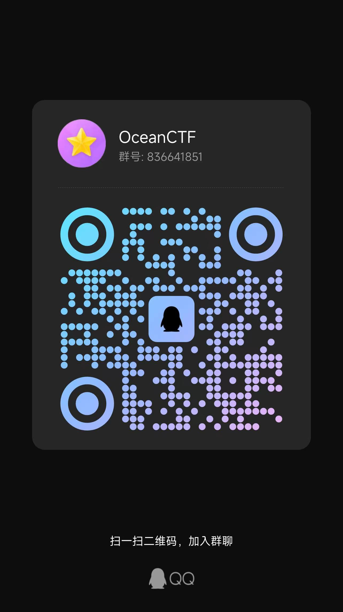

## License

[MIT](./LICENSE)

Copyright (c) 2022-present tongcb

## 截图

- 管理员登录
  

- Home
  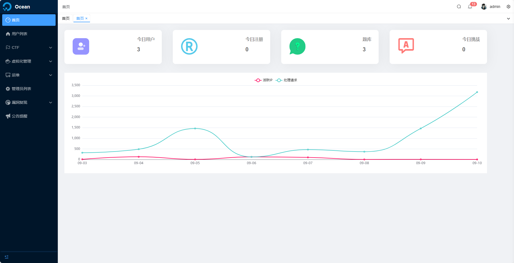

- Docker
  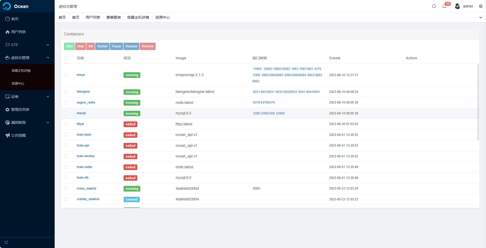

- 资源中心
  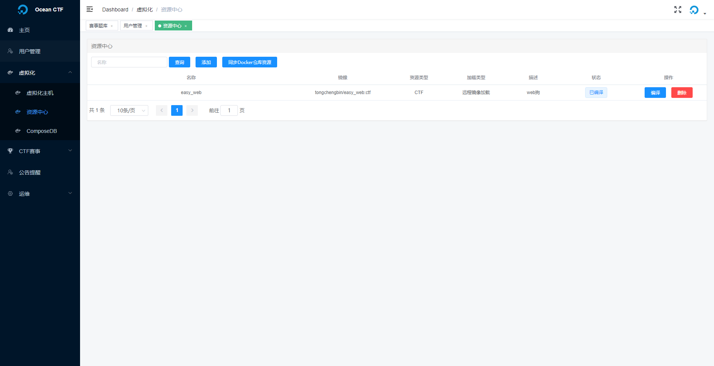
- 编译镜像

  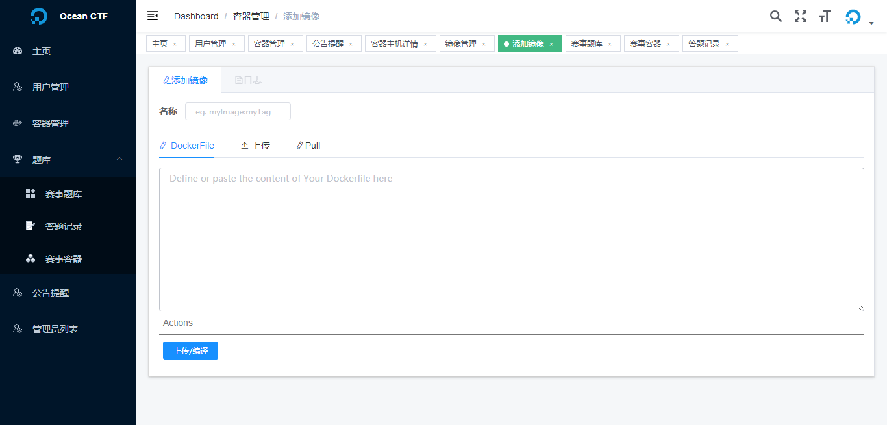

- 编译进度

  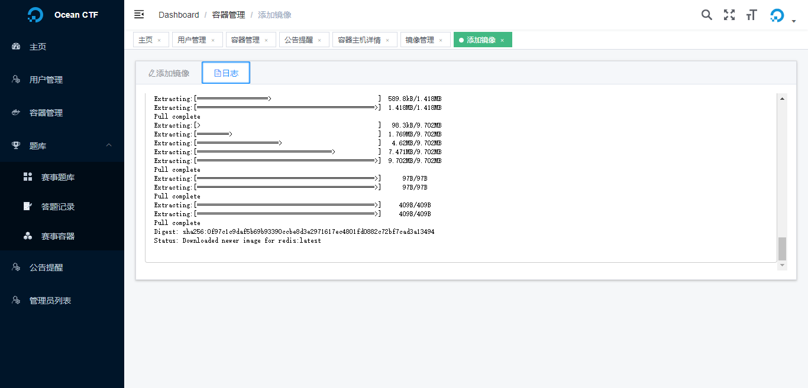

- 镜像列表
  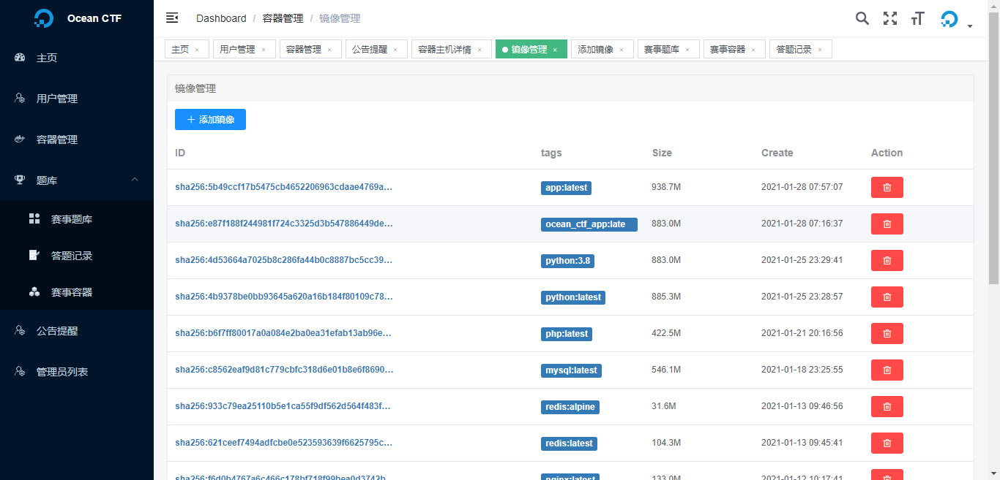

- 题目列表
  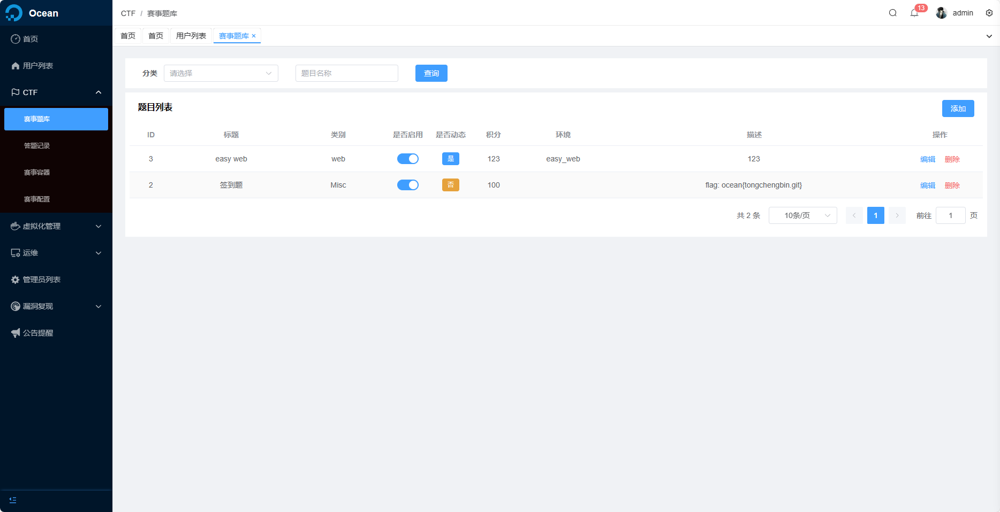
- 赛事环境
  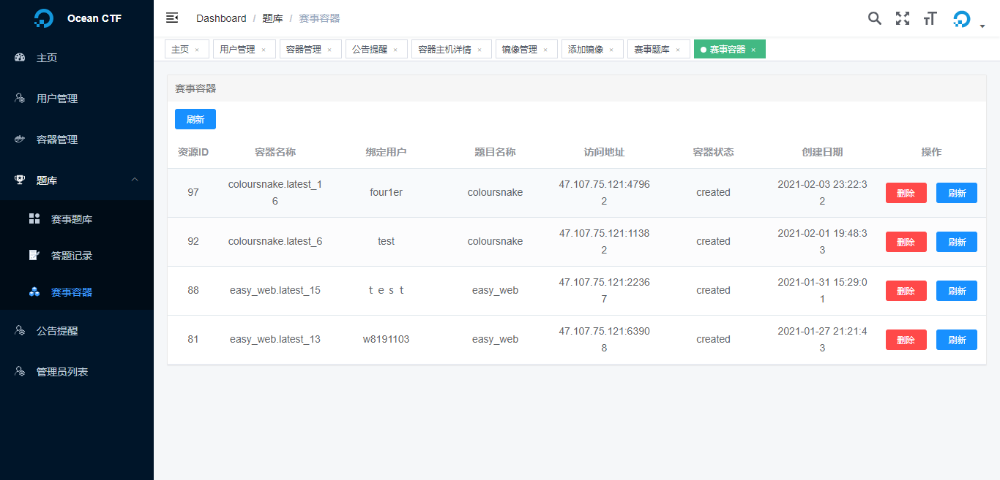
- 答题记录
  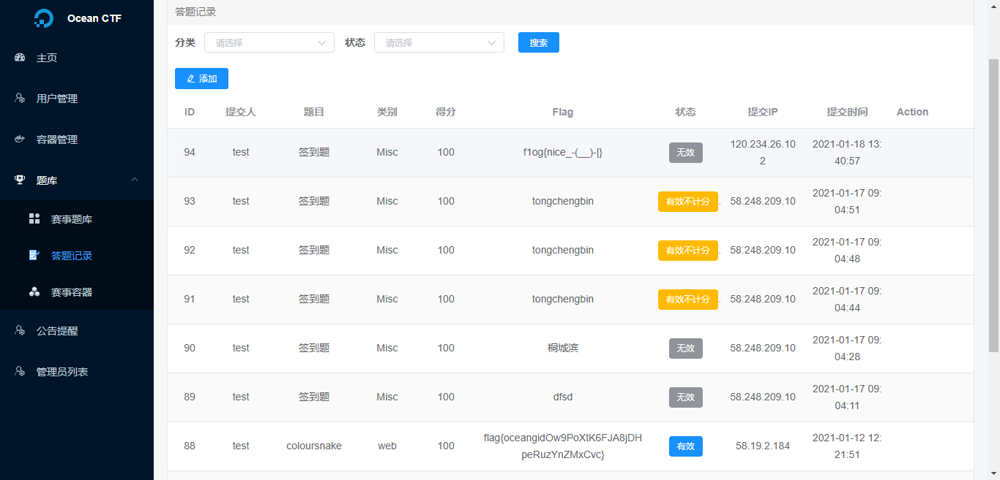

- 用户首页
  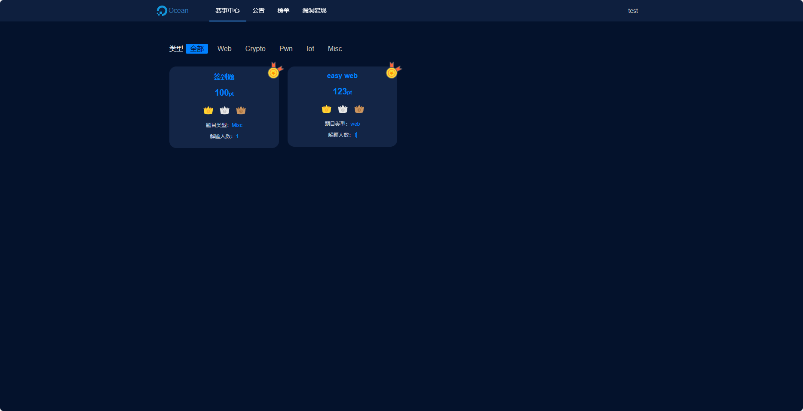

- 启动容器
  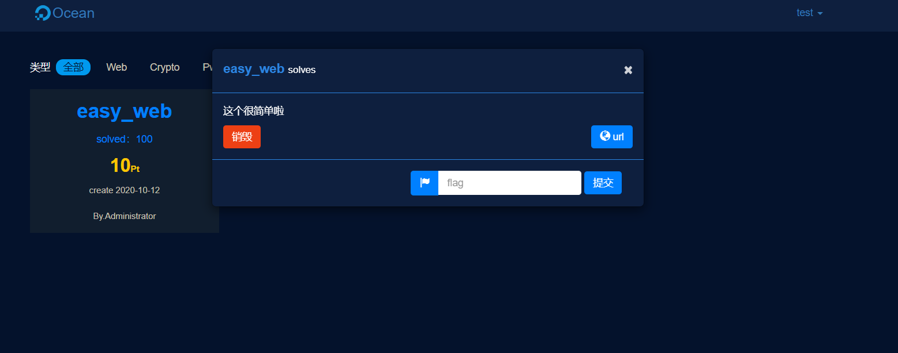

- 漏洞复现 Shell
  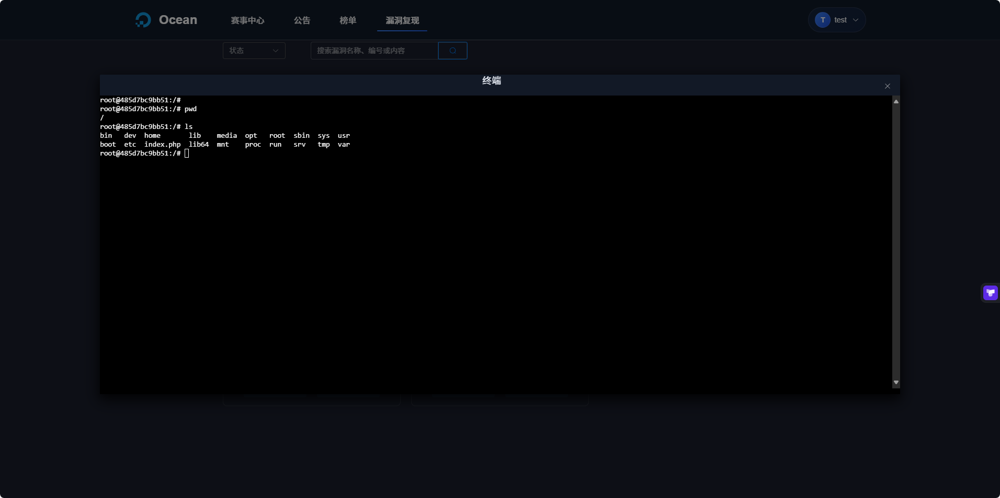
- 靶场
  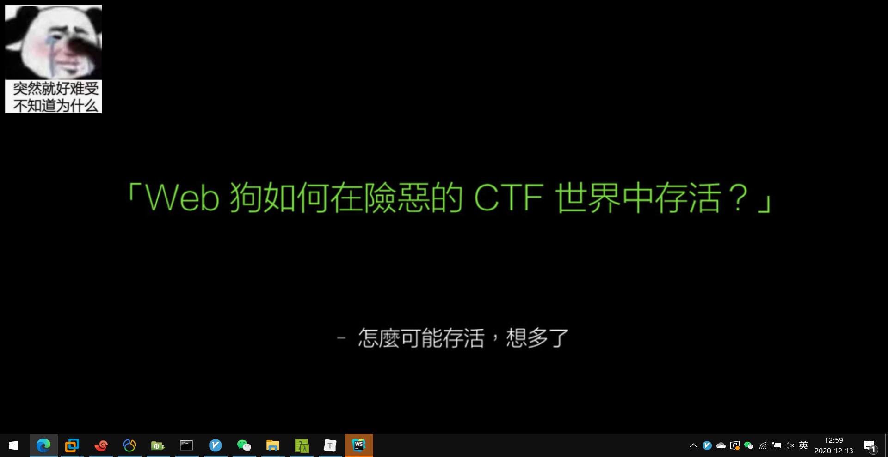

- 漏洞复现
  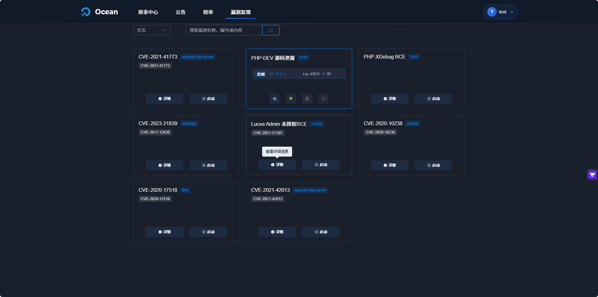
